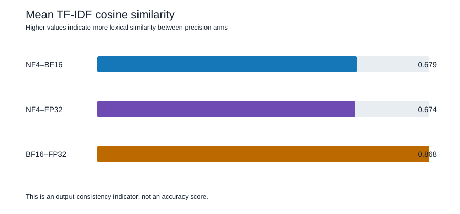

当视觉语言模型在 GPU 上运行时，只改变数值精度，同一张图像也可能生成略有不同的文本。本文记录了一项使用 **Qwen3-VL-4B-Instruct** 的小型受控实验。该模型是一个能同时处理图像和文本的多模态模型。

本文的目的并不是宣布某一种精度在所有情况下都最好，而是直观说明其中的权衡：较低精度通常可以降低显存需求，而较高精度能保留更多数值信息。



## 为什么要比较推理精度？

**推理（inference）** 是指使用已经训练完成的模型生成输出。在推理过程中，模型反复调用其学习到的 **权重（weights）**，即决定模型如何将输入转换为输出 token 的数值。

这些计算并不一定只能使用一种固定的数值格式。精度设置决定了用多少 bit 表示一个数。较少的 bit 通常意味着更低的显存占用，但也会使原始数值被更强地近似。这种近似可能改变模型生成的 token 序列。

对于图像描述、视觉检测和文档理解等多模态任务，这一点具有实际意义。因此，一个有用的首要问题是：*当只改变数值精度时，模型生成的描述是否仍然一致？*

## 什么是 NF4、BF16 和 FP32？

- **FP32**（32-bit floating point，32 位浮点数）为每个数使用相对较大的表示空间。它可以保留更多数值细节，但也需要更多显存。
- **BF16**（Brain Floating Point 16）使用 16 bit。它为深度学习计算而设计，在比 FP32 更低显存占用下保留较宽的数值范围。
- **NF4**（4-bit NormalFloat）是一种以 4 bit 存储模型权重的量化格式。**量化（quantization）** 是指用更少的 bit 表示数值。NF4 可大幅减少权重显存，但权重近似程度更高。本实验中，NF4 在加载量化权重后使用 BF16 进行计算。

这些名称描述的是数值表示方式，而不是模型规模或训练质量。三组实验均使用相同的模型架构和已训练 checkpoint。

### LoRA 和 QLoRA 微调中的量化

量化也广泛用于大语言模型的适配训练。**LoRA**（Low-Rank Adaptation，低秩适配）是一种参数高效微调方法：它不更新 base model 中的全部权重，而是冻结 base model，只训练称为 **adapter** 的小型附加矩阵。这样能显著减少需要训练的参数量。

实际使用中，base model 常以 **INT8** 或 4-bit 形式加载，以降低微调时的 GPU 显存需求。**QLoRA**（Quantized LoRA，量化 LoRA）将这一思想与 LoRA 结合：冻结的 base model 通常以 4-bit NF4 形式存储，而 LoRA adapter 及部分计算使用 BF16 等更高精度。这样可以在有限的 GPU 显存中微调原本难以容纳的模型。

QLoRA 是一种广为人知的*方法*，而不是 NF4 或 Double Quantization 的另一个名称 [2]。其常用方案结合了三项内容：LoRA adapter、用于冻结 base-model 权重的 **4-bit NormalFloat（NF4）** 量化，以及 **Double Quantization（二次量化）**。二次量化是指进一步量化量化常数本身，从而降低 4-bit 权重量化相关元数据的显存开销。原始 QLoRA 方法还引入了 paged optimizers，以帮助管理训练过程中的显存峰值。

这里需要严格区分相关术语。INT4 是对 4-bit 整数量化的统称，而 NF4 是一种为模型权重设计的 4-bit 归一化浮点格式。两者都能降低 base model 的权重显存，但它们不是相同的表示方式。量化能够减少 base model 的显存占用，但不会消除 activation、optimizer state 或可训练 LoRA adapter 所需的显存。

## 实验设置

本实验对同一对象的 34 张固定图像，分别以三种精度运行同一个模型：

### 图像来源

图像集包含结构耐火实验室照料的小狗 **JinDouer** 的 34 张照片。照片采集于实验室及其周边环境，记录了 JinDouer 在不同姿势、拍摄视角和日常场景中的状态。使用同一对象但具有多种可见姿态的图像，可以在主要主体身份保持不变的前提下，观察数值精度变化是否会影响模型生成的描述。


*图 1. JinDouer 图像集中的部分照片总览。*

| 项目 | 设置 |
| --- | --- |
| 模型 | Qwen3-VL-4B-Instruct |
| 任务 | 用 5–10 句简洁英文描述每张照片 |
| 图像 | 34 张固定图像 |
| 精度组别 | NF4、BF16、FP32 |
| 解码 | 确定性解码（`do_sample=false`） |
| 最大输出 | 384 个新 token |
| 最大图像像素 | 147,456 |
| GPU 环境 | NVIDIA vGPU-48GB，CUDA 12.8 |

三组实验的 prompt 完全一致。它要求模型只描述图像中直接可见的内容，例如外观、姿态、配件、附近物体、环境、光照和拍摄视角；同时明确禁止猜测品种、年龄、健康状况、情绪或身份。

图像、prompt、分辨率、模型和解码设置均保持不变，因此数值精度是主要的实验差异。

## 如何度量描述相似度？

实验比较同一张图像在两个精度设置下生成文本的措辞差异。每条描述先被转换为 **TF-IDF 向量** [1]。TF-IDF 会提高对单条描述重要、但不在全部描述中频繁出现的词语的权重。随后使用 **余弦相似度（cosine similarity）** 比较这些向量：

- 接近 1 的值表示两条描述使用了相似的重要词语；
- 较低的值表示两者的词语重合度较低。

例如，“charred exterior wall” 与 “blackened outside wall” 描述的是相关概念，但它们使用了不同词语，因此得分会低于 1。这是 **文本一致性** 的度量，而不是对任何描述是否符合图像事实的判断。

逆文档频率（IDF）统计在全部 102 条描述上拟合，即 34 张图像乘以三种精度设置。

## 结果

各组之间的平均两两相似度如下：

| 比较 | 平均值 | 中位数 | 最小值 | 最大值 |
| --- | ---: | ---: | ---: | ---: |
| NF4–BF16 | 0.679 | 0.669 | 0.600 | 0.822 |
| NF4–FP32 | 0.674 | 0.668 | 0.556 | 0.762 |
| BF16–FP32 | **0.868** | **0.863** | 0.685 | 1.000 |



核心结果是：BF16 与 FP32 的生成措辞彼此更相似，相比之下，它们与 NF4 的相似度更低。因此，在这项具体测试中，NF4 是文本措辞变化更明显的一组。


该分布表明，BF16–FP32 在不同图像上维持了相对较高的相似度，而涉及 NF4 的比较则更低且变动更大。并非每张图像都会得到相同结论：一些图像生成的描述几乎一致，另一些图像对精度更加敏感。


## 交互式比较面板

下方 dashboard 以可浏览的方式展示同一项实验，包括汇总卡片、运行时间与显存图表、逐图切换，以及三种精度生成描述的并排比较。34 张实验图像已经作为静态站点资源包含在项目中，dashboard 也保留了本地图片选择器，方便替换为本地图片。



## 这些结果意味着什么？

结果支持以下三项实际观察：

1. **对于本任务，BF16 可以作为接近 FP32 的数值替代方案。** 两者的平均相似度为 0.868，表明在确定性解码下生成的措辞整体相近。
2. **NF4 对输出分布的改变更明显。** 它与 BF16、FP32 的平均相似度分别为 0.679 和 0.674。这并不自动意味着 NF4 不可用，而是说明其节省显存的近似应在目标任务的数据上验证。
3. **显存与准确性是不同的问题。** 更少的 bit 通常能降低模型权重显存，但并不保证推理一定更快，也不保证所有视觉细节都会被保留。部署选择应测量应用真正关注的指标。

## 查看单个输出

两两相似度适合总结整个数据集，但仍应辅以人工审查。当两条描述不同，需要判断差异只是无害的措辞变化，还是遗漏物体、数量变化或不正确的视觉陈述。

以下示例使用图像 `JD-POS-001`。三组运行使用的图像、prompt、模型 checkpoint 和解码设置完全一致。

### NF4 输出

> A small dog with a tan and dark coat sits on a gray concrete surface, its front paws flat and its body slightly curled. The dog's head is tilted upward, facing the camera, with its tongue slightly out and ears flopped forward. A black leash extends from the dog's left side, disappearing out of frame. The dog's tail is dark and appears to be curled slightly upward. The lighting is even and diffused, suggesting an overcast day or indoor setting with no strong shadows. The camera angle is high, looking down at the dog from above, capturing its full upper body and the immediate ground around it. The concrete shows minor cracks and a few small debris particles. No other objects or people are visible in the frame.

### BF16 输出

> A small dog with a dark back and lighter brown fur on its head and legs sits on a gray concrete surface. Its front paws are visible, and its tail is curled slightly upward. The dog's head is tilted slightly, and its mouth is open with its tongue hanging out. A black leash extends from the dog's collar toward the left side of the frame. The concrete floor has visible cracks and minor imperfections. The lighting is even and diffused, suggesting an overcast day or indoor setting. The photograph is taken from a high angle, looking down at the dog. No other objects or people are visible in the immediate vicinity.

### FP32 输出

> A small dog with a dark back and lighter brown fur on its head and legs sits on a gray concrete surface. Its front paws are visible, and its tail is curled slightly upward. The dog's ears are floppy and positioned to the sides, and its mouth is open with its pink tongue hanging out. A black leash extends from the dog's collar toward the left edge of the frame. The ground shows minor cracks and a small debris fragment near the right edge. The lighting is even and diffused, suggesting an overcast day or indoor setting with ambient light. The photograph is taken from a high angle, looking down at the dog, which is facing the camera.

三条描述对主要场景的判断一致：一只小狗坐在混凝土地面上，从上方拍摄，带有牵引绳，嘴巴张开。差异主要体现在措辞和细节选择上。NF4 提到了狗蜷起的身体和画面中没有其他物体；BF16 与 FP32 则以略有不同的方式描述毛色和混凝土地面的细节。这一质性示例说明：相似度分数之后仍应进行人工检查。

作为对照，两条描述即使表面措辞不同，也可能描述的是相似场景：

```text
"A dog sits on a concrete surface with its head tilted upward."
"The dog is seated on the ground and looks toward the camera."
```

相反，物体、姿态或可见物体数量发生变化时，可能会影响下游视觉检测系统。仅凭本文中的分数无法区分这些情况。

## 局限性

- 这是一个使用 34 张图像和一个图像描述 prompt 的小规模研究。
- TF-IDF 余弦相似度度量词语使用情况，而非事实准确性、视觉 groundedness 或实际可用性。
- FP32 在这里是数值参考，而不是绝对真值。
- 图像、prompt、解码策略、processor 设置和模型 checkpoint 均被固定。不同任务或解码设置对精度的敏感性可能不同。
- 本实验不能给出适用于所有多模态工作负载的 NF4、BF16 与 FP32 通用排名。

## 要点总结

在这一固定的 Qwen3-VL 图像描述任务中，BF16 和 FP32 是文本一致性最高的一组，而 NF4 产生了更多措辞变化。当 GPU 显存是主要限制条件时，NF4 仍然很有吸引力；但不应假定它的输出会自动匹配更高精度推理，而应使用有代表性的数据进行检查。

最可靠的流程是同时比较资源消耗和任务质量：测量显存、延迟和吞吐量，并评估生成结果是否能正确支持图像和实际决策需求。

## 术语表

- **多模态模型：** 可处理多种输入类型（例如图像和文本）的模型。
- **推理：** 运行已经训练完成的模型以生成输出。
- **模型权重：** 模型内部学习到的数值。
- **精度：** 表示数值所使用的 bit 数。
- **量化：** 用较少的 bit 存储数值，以降低显存或计算成本。
- **TF-IDF：** 一种文本表示方法，用于突出对特定文本重要的词语。
- **余弦相似度：** 比较两个向量方向的分数；本文中用于衡量描述措辞的相似度。

## 参考文献

1. Salton, G., & Buckley, C. (1988). Term-weighting approaches in automatic text retrieval. *Information Processing & Management*, 24(5), 513–523. https://doi.org/10.1016/0306-4573(88)90021-0
2. Dettmers, T., Pagnoni, A., Holtzman, A., & Zettlemoyer, L. (2023). QLoRA: Efficient finetuning of quantized LLMs. *Advances in Neural Information Processing Systems*, 36. https://arxiv.org/abs/2305.14314
