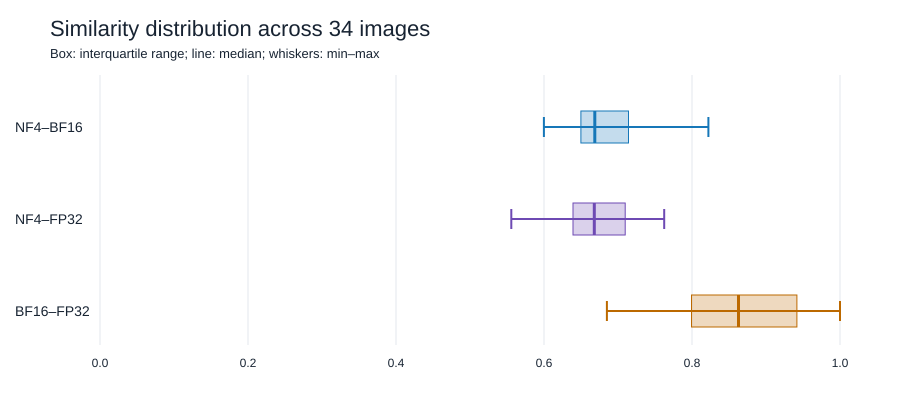
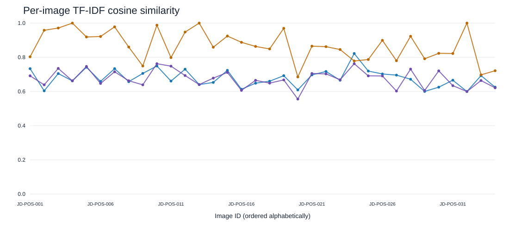

When a vision-language model runs on a GPU, the same image can produce slightly different text when its numerical precision changes. This post documents a small, controlled experiment with **Qwen3-VL-4B-Instruct**, a multimodal model that accepts both images and text.

The goal is not to claim that one precision is universally best. Instead, it is to make the trade-off visible: lower precision can reduce memory requirements, while higher precision preserves more numerical information.



## Why compare inference precision?

**Inference** means using an already-trained model to generate an answer. During inference, the model repeatedly applies its learned **weights**: numerical values that control how it transforms the input into output tokens.

Those calculations do not have to use one fixed number format. A precision setting determines how many bits are used to represent numbers. Fewer bits generally mean less memory, but they also approximate the original values more aggressively. That approximation can change the sequence of tokens generated by the model.

For a multimodal model, this matters in practical deployments such as image captioning, visual inspection, and document understanding. A useful first question is therefore: *how consistent are the generated descriptions when only precision changes?*

## What are NF4, BF16, and FP32?

- **FP32** (32-bit floating point) uses a relatively large representation for each number. It can preserve more numerical detail, but it also needs more memory.
- **BF16** (Brain Floating Point 16) uses 16 bits. It was designed for efficient deep-learning computation and keeps a wide numerical range while using less memory than FP32.
- **NF4** (4-bit NormalFloat) is a quantization format for storing model weights with four bits. **Quantization** means representing values with fewer bits than the original format. NF4 greatly reduces weight memory, but the weights are more approximate. In this experiment, NF4 used BF16 for its computation after loading quantized weights.

These names describe numerical representation, not model size or training quality. The model architecture and learned checkpoint were kept the same in all three runs.

### Quantization in LoRA and QLoRA fine-tuning

Quantization is also widely used when adapting large language models. **LoRA** (Low-Rank Adaptation) is a parameter-efficient fine-tuning method: instead of updating every weight in the base model, it keeps the base model frozen and trains small additional matrices called **adapters**. This greatly reduces the number of trainable parameters.

In practice, the base model is often loaded in **INT8** or 4-bit form to reduce GPU memory during fine-tuning. **QLoRA** (Quantized LoRA) combines this idea with LoRA: the frozen base model is commonly stored in 4-bit NF4, while the LoRA adapters and parts of the computation use a higher precision such as BF16. This makes it possible to fine-tune models that would otherwise not fit in the available GPU memory.

QLoRA is a well-known *method*, rather than another name for NF4 or Double Quantization alone [2]. Its commonly used recipe combines three ideas: LoRA adapters, **4-bit NormalFloat (NF4)** quantization for the frozen base-model weights, and **Double Quantization**. Double Quantization means quantizing the quantization constants themselves, which further reduces the memory used by the metadata associated with 4-bit weight quantization. The original QLoRA approach also introduced paged optimizers to help manage memory peaks during training.

It is useful to distinguish the terms carefully. INT4 is a general name for four-bit integer quantization, whereas NF4 is a four-bit normalized floating-point format designed for model weights. Both reduce the memory needed to store the base model, but they are not the same representation. Quantization reduces base-model memory; it does not remove the memory required for activations, optimizer states, or the trainable LoRA adapters.

## Experimental setup

The experiment used 34 fixed images of the same subject and ran the same model three times:

### Image source

The image set contains 34 photographs of **JinDouer**, a dog cared for by the Structural Fire Laboratory. The photographs were collected in and around the laboratory and capture JinDouer in a range of poses, viewpoints, and everyday settings. Using one subject with varied visible postures makes it possible to examine whether changes in numerical precision affect the model's descriptions while the identity of the main subject remains constant.


*Figure 1. A visual overview of selected photographs from the JinDouer image set.*

| Item | Setting |
| --- | --- |
| Model | Qwen3-VL-4B-Instruct |
| Task | Describe each photograph in 5–10 concise English sentences |
| Images | 34 fixed images |
| Precision arms | NF4, BF16, FP32 |
| Decoding | Deterministic (`do_sample=false`) |
| Maximum output | 384 new tokens |
| Maximum image pixels | 147,456 |
| GPU environment | NVIDIA vGPU-48GB, CUDA 12.8 |

The prompt was held constant. It asked the model to mention only directly visible details, such as appearance, pose, accessories, nearby objects, lighting, and camera perspective. It also explicitly prohibited guessing the breed, age, health, emotional state, or identity.

Keeping the image, prompt, resolution, model, and decoding settings fixed means that precision is the main experimental difference.

## How was caption similarity measured?

The experiment compares the wording produced for the same image by two precision settings. Each caption was converted into a **TF-IDF vector** [1]. TF-IDF gives more weight to words that are important in one caption but not common across every caption. The vectors were then compared with **cosine similarity**:

- a value near 1 means that the two captions use similar important words;
- a lower value means that their wording overlaps less.

For example, “charred exterior wall” and “blackened outside wall” describe related ideas but use different words, so their score would be below 1. This is a measure of **textual consistency**, not a measure of whether either description is visually correct.

The inverse-document-frequency (IDF) statistics were fitted over all 102 captions: 34 images multiplied by three precision settings.

## Results

The mean pairwise similarities were:

| Comparison | Mean | Median | Minimum | Maximum |
| --- | ---: | ---: | ---: | ---: |
| NF4–BF16 | 0.679 | 0.669 | 0.600 | 0.822 |
| NF4–FP32 | 0.674 | 0.668 | 0.556 | 0.762 |
| BF16–FP32 | **0.868** | **0.863** | 0.685 | 1.000 |


The central result is that BF16 and FP32 produced more similar wording to each other than either format produced to NF4. NF4 was therefore the arm with the largest lexical change in this particular test.



The distribution shows that the BF16–FP32 comparison remained relatively high across the images, while the NF4 comparisons were lower and more variable. The result was not identical for every image: some images produced nearly matching captions, and others were more sensitive to precision.



## Interactive comparison dashboard

The following dashboard presents the same experiment in a browsable layout. It includes summary cards, runtime and memory charts, per-image navigation, and a side-by-side comparison of the three generated captions. The 34 experiment images are included as static site assets, and the dashboard also keeps its local image picker for optional replacement images.



## What do the results mean?

The results support three practical observations:

1. **BF16 can be a close numerical alternative to FP32 for this task.** Their mean similarity was 0.868, indicating broadly similar wording under deterministic decoding.
2. **NF4 changes the output distribution more noticeably.** Its mean similarities with BF16 and FP32 were 0.679 and 0.674. This does not automatically make NF4 unusable; it means that its memory-saving approximation deserves task-specific validation.
3. **Memory and accuracy are different questions.** Using fewer bits generally lowers the memory needed for model weights, but it does not guarantee faster inference or preserve every visual detail. A deployment decision should measure the metrics that matter for the application.

## Looking at individual outputs

Pairwise similarity is useful for summarising a dataset, but it should be complemented by a manual review. When two captions differ, inspect whether the difference is harmless wording, a missed object, a changed count, or an incorrect visual claim.

The following example uses `JD-POS-001`. The image, prompt, model checkpoint, and decoding settings were identical in all three runs.

### NF4 output

> A small dog with a tan and dark coat sits on a gray concrete surface, its front paws flat and its body slightly curled. The dog's head is tilted upward, facing the camera, with its tongue slightly out and ears flopped forward. A black leash extends from the dog's left side, disappearing out of frame. The dog's tail is dark and appears to be curled slightly upward. The lighting is even and diffused, suggesting an overcast day or indoor setting with no strong shadows. The camera angle is high, looking down at the dog from above, capturing its full upper body and the immediate ground around it. The concrete shows minor cracks and a few small debris particles. No other objects or people are visible in the frame.

### BF16 output

> A small dog with a dark back and lighter brown fur on its head and legs sits on a gray concrete surface. Its front paws are visible, and its tail is curled slightly upward. The dog's head is tilted slightly, and its mouth is open with its tongue hanging out. A black leash extends from the dog's collar toward the left side of the frame. The concrete floor has visible cracks and minor imperfections. The lighting is even and diffused, suggesting an overcast day or indoor setting. The photograph is taken from a high angle, looking down at the dog. No other objects or people are visible in the immediate vicinity.

### FP32 output

> A small dog with a dark back and lighter brown fur on its head and legs sits on a gray concrete surface. Its front paws are visible, and its tail is curled slightly upward. The dog's ears are floppy and positioned to the sides, and its mouth is open with its pink tongue hanging out. A black leash extends from the dog's collar toward the left edge of the frame. The ground shows minor cracks and a small debris fragment near the right edge. The lighting is even and diffused, suggesting an overcast day or indoor setting with ambient light. The photograph is taken from a high angle, looking down at the dog, which is facing the camera.

The three captions agree on the main scene: a small dog sitting on concrete, viewed from above, with a leash and an open mouth. Their differences are mostly in wording and detail selection. NF4 mentions the dog's curled body and the absence of other objects, while BF16 and FP32 describe the fur pattern and concrete details in slightly different ways. This is a qualitative example of why a similarity score should be followed by manual inspection.

For comparison, two captions can describe a similar scene even when their surface wording differs:

```text
"A dog sits on a concrete surface with its head tilted upward."
"The dog is seated on the ground and looks toward the camera."
```

By contrast, a changed object, pose, or number of visible items may matter for a downstream inspection system. The scores in this post cannot tell those cases apart on their own.

## Limitations

- This is a small-scale study with 34 images and one captioning prompt.
- TF-IDF cosine similarity measures word usage, not factual correctness, groundedness, or usefulness.
- FP32 is a numerical reference in this comparison, not an absolute ground truth.
- The images, prompt, decoding policy, processor settings, and model checkpoint were fixed. Different tasks or decoding settings may produce different sensitivity to precision.
- The experiment does not establish a universal ranking of NF4, BF16, and FP32 for all multimodal workloads.

## Key takeaways

For this fixed Qwen3-VL captioning task, BF16 and FP32 were the most textually consistent pair, while NF4 produced more variation in wording. NF4 remains attractive when GPU memory is the limiting resource, but its outputs should be checked on representative data rather than assumed to match higher-precision inference.

The most reliable workflow is to compare both resource usage and task quality: measure memory, latency, and throughput, then evaluate whether the generated answers remain correct for the images and decisions that matter.

## Glossary

- **Multimodal model:** A model that works with more than one input type, such as images and text.
- **Inference:** Running a trained model to generate an output.
- **Model weights:** Learned numerical values inside the model.
- **Precision:** The number of bits used to represent numerical values.
- **Quantization:** Storing values with fewer bits to reduce memory or computation costs.
- **TF-IDF:** A text representation that highlights words important to particular documents.
- **Cosine similarity:** A score comparing the direction of two vectors; here it measures similarity between caption wording.

## References

1. Salton, G., & Buckley, C. (1988). Term-weighting approaches in automatic text retrieval. *Information Processing & Management*, 24(5), 513–523. https://doi.org/10.1016/0306-4573(88)90021-0
2. Dettmers, T., Pagnoni, A., Holtzman, A., & Zettlemoyer, L. (2023). QLoRA: Efficient finetuning of quantized LLMs. *Advances in Neural Information Processing Systems*, 36. https://arxiv.org/abs/2305.14314
