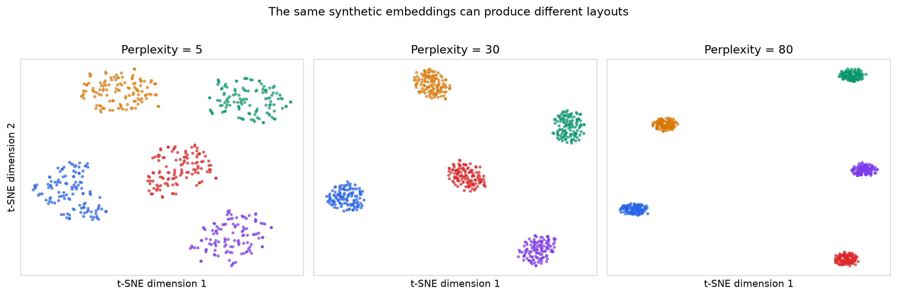
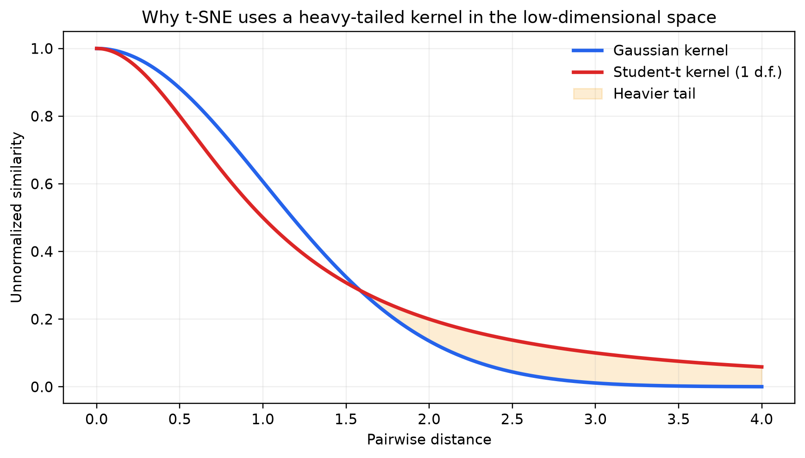

在文本检索、RAG 和问答数据集研究中，我们经常先使用 embedding 模型把问题、答案或知识单元编码成高维向量。一个 BGE-M3 向量可能包含上千个维度，我们可以计算向量之间的余弦相似度，却无法直接观察这些点在高维空间中的分布。



**t-distributed Stochastic Neighbor Embedding（t-SNE）**提供了一种可视化方法：它把高维向量映射到二维或三维空间，并尽量保留原空间中的局部邻居关系。

这句话里有三个容易混淆的重点：

1. t-SNE 保存的主要是邻居关系，而不是所有成对距离；
2. t-SNE 优化的是两个概率分布之间的差异，而不是直接最小化坐标误差；
3. t-SNE 图适合探索数据，却不能单独证明数据多样性、知识覆盖率或检索性能有所提高。

本文从这三个问题出发，逐步解释 t-SNE 的目标函数，并给出一个可复现的 Python 示例。

## 1. 从高维文本向量到邻居关系

设高维数据为


$$
X=\{x_1,x_2,\ldots,x_n\}, \qquad x_i\in\mathbb{R}^{D},
$$


其中，$x_i$ 可以是一个问题或知识单元的文本 embedding。我们的目标是获得低维坐标


$$
Y=\{y_1,y_2,\ldots,y_n\}, \qquad y_i\in\mathbb{R}^{2}.
$$


一种直接思路是要求所有低维距离都等于原始高维距离。然而，高维空间中的所有距离通常无法同时、无失真地压缩到二维平面。t-SNE 因此换了一个问题：

> 如果两个样本在高维空间中是近邻，那么它们在低维空间中也应具有较高的邻近概率。

它关注的不是逐一复制全部距离，而是尽量不拆散原本的局部邻居。

## 2. 高维空间：把距离转换为概率

对于以 $x_i$ 为中心的局部邻域，t-SNE 使用高斯核定义 $x_j$ 成为其邻居的条件概率：


$$
p_{j\mid i}
=
\frac{
\exp\left(-\lVert x_i-x_j\rVert^2/2\sigma_i^2\right)
}{
\sum_{k\ne i}
\exp\left(-\lVert x_i-x_k\rVert^2/2\sigma_i^2\right)
},
\qquad p_{i\mid i}=0.
$$


这里：

- 距离越小，指数项越大，邻居概率越高；
- $\sigma_i$ 决定以 $x_i$ 为中心时考虑多大的局部范围；
- 分母将相似度归一化，使所有候选邻居的概率之和为 1。

随后，t-SNE 将条件概率对称化：


$$
p_{ij}=\frac{p_{j\mid i}+p_{i\mid j}}{2n}.
$$


这样得到的 $P=\{p_{ij}\}$ 可以理解为高维空间中的邻居概率分布。

### Perplexity 控制的是什么？

t-SNE 不要求所有数据点使用相同的 $\sigma_i$。算法通过二分搜索调整每个 $\sigma_i$，使其条件概率分布达到用户设定的 perplexity：


$$
\operatorname{Perp}(P_i)=2^{H(P_i)},
$$


其中


$$
H(P_i)=-\sum_j p_{j\mid i}\log_2 p_{j\mid i}.
$$


Perplexity 可以近似理解为算法关注的“有效邻居数量”，但它不是严格的邻居个数。较小的 perplexity 更强调非常局部的关系，较大的 perplexity 会考虑更宽的邻域。因此，perplexity 变化可能显著改变最终布局。



*图 1. 相同的合成高维数据在不同 perplexity 下形成不同的二维布局。颜色只表示生成数据时使用的类别，用于帮助观察投影变化。*

## 3. 低维空间：为什么不用另一个高斯分布？

在低维空间中，t-SNE 使用自由度为 1 的 Student-t 分布定义相似度：


$$
q_{ij}
=
\frac{
\left(1+\lVert y_i-y_j\rVert^2\right)^{-1}
}{
\sum_{k\ne l}
\left(1+\lVert y_k-y_l\rVert^2\right)^{-1}
},
\qquad q_{ii}=0.
$$


Student-t 分布的尾部比高斯分布更重。随着距离增大，它的相似度衰减得更慢：



*图 2. Student-t 核具有更重的尾部，使低维空间有更大的自由度将不相似的点推开。图中曲线是未归一化相似度，仅用于解释核函数形状。*

这项设计用于缓解 **crowding problem（拥挤问题）**。在高维空间中，一个点周围可以容纳许多处于不同方向的近邻；压缩到二维后，有限的平面空间难以同时容纳这些关系。如果低维空间仍使用高斯核，大量点容易挤在一起。重尾分布允许中远距离的点在二维平面中被分得更开。

## 4. 为什么目标函数是 KL divergence？

到这里，我们有了两个分布：

- $P=\{p_{ij}\}$：高维空间中的邻居概率；
- $Q=\{q_{ij}\}$：低维空间中的邻居概率。

t-SNE 通过最小化 Kullback--Leibler divergence，使 $Q$ 尽量接近 $P$：


$$
\mathcal{L}
=
KL(P\parallel Q)
=
\sum_{i\ne j}p_{ij}\log\frac{p_{ij}}{q_{ij}}.
$$


这个目标函数可以从两种错误来理解。

### 错误一：把真正的邻居拆散

如果两个点在高维空间中非常接近，$p_{ij}$ 会较大。如果它们在低维空间中相距很远，$q_{ij}$ 会很小，于是


$$
p_{ij}\log\frac{p_{ij}}{q_{ij}}
$$


会产生较大的损失。优化过程因而会把这两个点拉近。

### 错误二：让原本不相似的点靠得过近

如果 $p_{ij}$ 很小，即使 $q_{ij}$ 偏大，这一项受到 $p_{ij}$ 的加权后也相对有限。因此，$KL(P\parallel Q)$ 对“拆散真实近邻”的惩罚通常强于对“制造虚假近邻”的惩罚。

这正是 t-SNE 擅长展示局部簇、却不保证全局几何结构的原因之一。

需要注意，KL divergence 不对称：


$$
KL(P\parallel Q)\ne KL(Q\parallel P).
$$


t-SNE 选择 $KL(P\parallel Q)$，意味着高维分布 $P$ 是需要保留的参考，而低维分布 $Q$ 是被优化的近似。

## 5. 梯度下降如何移动这些点？

对低维坐标 $y_i$ 求导，可得到：


$$
\frac{\partial \mathcal{L}}{\partial y_i}
=
4\sum_j
(p_{ij}-q_{ij})
(y_i-y_j)
\left(1+\lVert y_i-y_j\rVert^2\right)^{-1}.
$$


可以把它直观理解为吸引力与排斥力的共同作用：

- 当 $p_{ij}>q_{ij}$ 时，低维空间低估了两点的邻近程度，它们需要被拉近；
- 当 $p_{ij}<q_{ij}$ 时，低维空间高估了两点的邻近程度，它们需要被推远。

算法从一组初始低维坐标出发，通过多轮梯度更新降低 KL divergence，最终形成可视化布局。由于优化问题是非凸的，不同初始化和随机种子可能得到不同的坐标。

## 6. 一个可复现的文本示例

下面的示例先用 BGE-M3 编码问题，再运行 t-SNE。代码中的变量名和注释使用英文，便于直接复用。

```python
from sentence_transformers import SentenceTransformer
from sklearn.manifold import TSNE
import matplotlib.pyplot as plt
import numpy as np


questions = [
    "How should fire-damaged concrete be assessed?",
    "What tests are required after a structural fire?",
    "How is residual concrete strength calculated?",
    "What is the purpose of post-fire inspection?",
]

model = SentenceTransformer("BAAI/bge-m3")
embeddings = model.encode(
    questions,
    normalize_embeddings=True,
)

# The small perplexity is only suitable for this four-sample demonstration.
tsne = TSNE(
    n_components=2,
    perplexity=2,
    init="pca",
    learning_rate="auto",
    max_iter=1000,
    random_state=42,
)

coordinates = tsne.fit_transform(np.asarray(embeddings))

plt.scatter(coordinates[:, 0], coordinates[:, 1])
for index, point in enumerate(coordinates):
    plt.annotate(f"Q{index + 1}", point)

plt.xlabel("t-SNE dimension 1")
plt.ylabel("t-SNE dimension 2")
plt.title("t-SNE projection of question embeddings")
plt.tight_layout()
plt.show()
```

对于实际数据集，建议至少记录：

| Setting | Example |
| --- | --- |
| Embedding model | `BAAI/bge-m3` |
| Input field | English question text only |
| Preprocessing | L2-normalized embeddings |
| Number of dimensions | 2 |
| Perplexity | 30 |
| Initialization | PCA |
| Learning rate | Auto |
| Iterations | 1,000 |
| Random seed | 42 |

只报告“使用 t-SNE 降维”是不够的，因为这些设置都会影响结果。

## 7. 比较原始问题、新增问题与知识单元

如果希望把以下三类数据画在同一张图中：

- original questions；
- added questions；
- knowledge units；

应先使用同一个 embedding 模型编码全部文本，再拼接向量并执行**一次联合 t-SNE 拟合**：

```python
all_embeddings = np.vstack(
    [
        original_question_embeddings,
        added_question_embeddings,
        knowledge_unit_embeddings,
    ]
)

all_coordinates = tsne.fit_transform(all_embeddings)
```

不能分别对三组数据执行三次 t-SNE 后再把结果叠加。每次 t-SNE 都会产生一个新的、可任意旋转和平移的坐标系，分别拟合得到的坐标不具有直接可比性。

如果比较数据扩增前后，也应使用共同投影，或对所有版本的点联合拟合。即便如此，图上的“移动”仍不自动代表质量提升，因为新增点会改变整个优化问题。

适合论文或博客的图题可以写为：

> **t-SNE projection of question and knowledge-unit embeddings before and after dataset expansion.** Gray and blue points represent the original and added questions, respectively, while orange points represent the knowledge units.

## 8. t-SNE 图能说明什么？

t-SNE 适合支持以下探索性观察：

- 某些问题是否形成局部语义邻域；
- 新增问题是否只聚集在原有问题附近；
- 是否存在远离其他样本的异常点；
- 问题与相关知识单元是否在局部区域中邻近；
- 不同问题类型是否表现出一定的局部结构。

这些观察应使用“suggests”“indicates a local pattern”或“supports exploratory inspection”等谨慎表述，而不应直接写成因果或性能结论。

## 9. t-SNE 图不能单独证明什么？

### 坐标轴没有工程含义

`t-SNE dimension 1` 和 `t-SNE dimension 2` 只是优化得到的坐标，不能解释为火灾严重程度、问题难度或规范相关性。

### 簇间距离不代表可靠的全局语义距离

两个簇在图上相距很远，不意味着它们在原始 embedding 空间中具有同等程度的语义差异。

### 簇的面积和密度不等于数据质量

一个分布更分散的数据集不一定更多样，也可能包含噪声、错误改写或语义漂移。

### 漂亮的分群不等于真实类别结构

t-SNE 倾向于突出局部邻域。即使原始数据没有清晰的离散类别，投影也可能呈现视觉上分离的区域。

### t-SNE 不能替代定量评估

如果研究问题是“数据扩增是否提高了多样性和覆盖率”，还应报告：

- pairwise cosine similarity；
- nearest-neighbor similarity；
- exact and near-duplicate rates；
- knowledge-unit coverage；
- retrieval Recall@k 或 evidence hit rate；
- 下游模型性能及人工质量审核结果。

t-SNE 是探索性证据，而不是这些指标的替代品。

## 10. 一个实用的检查清单

在发布 t-SNE 图之前，可以逐项确认：

1. 所有比较对象是否使用同一个 embedding 模型和同一种文本字段？
2. 比较组是否在一次联合 t-SNE 中拟合？
3. 是否报告 perplexity、初始化、迭代次数和随机种子？
4. 是否固定数据版本并保存输入文件的 hash？
5. 是否比较多个 perplexity 或随机种子，确认主要局部模式具有一定稳定性？
6. 图题是否明确颜色、点的数量和数据分组？
7. 结论是否避免把二维全局距离当作原始语义距离？
8. 是否有独立的定量指标支撑数据多样性、覆盖率或检索性能结论？

## 结语

t-SNE 的核心不是“把高维坐标压缩成二维坐标”，而是先把高维和低维空间都描述成邻居概率分布，再通过最小化


$$
KL(P\parallel Q)
$$


尽量保留高维空间中的局部邻域。高维空间使用高斯概率刻画邻居，低维空间使用重尾 Student-t 分布缓解拥挤问题，而 KL divergence 使优化过程特别重视不要拆散真正的近邻。

这也决定了它的边界：t-SNE 非常适合探索 embedding 空间中的局部结构，但二维图不能替代原始空间中的定量分析。对于 QA 扩增与 RAG 知识库研究，最可靠的做法是将 t-SNE 与重复率、余弦相似度、知识覆盖率和检索指标结合使用。

## References

1. van der Maaten, L., & Hinton, G. (2008). Visualizing Data using t-SNE. *Journal of Machine Learning Research, 9*, 2579–2605.
2. van der Maaten, L. (2014). Accelerating t-SNE using Tree-Based Algorithms. *Journal of Machine Learning Research, 15*, 3221–3245.
3. Wattenberg, M., Viégas, F., & Johnson, I. (2016). How to Use t-SNE Effectively. *Distill*. https://doi.org/10.23915/distill.00002

