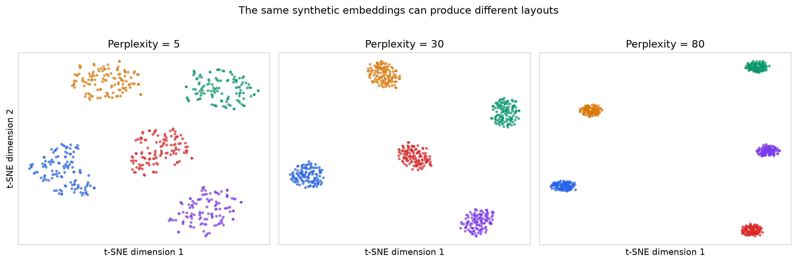
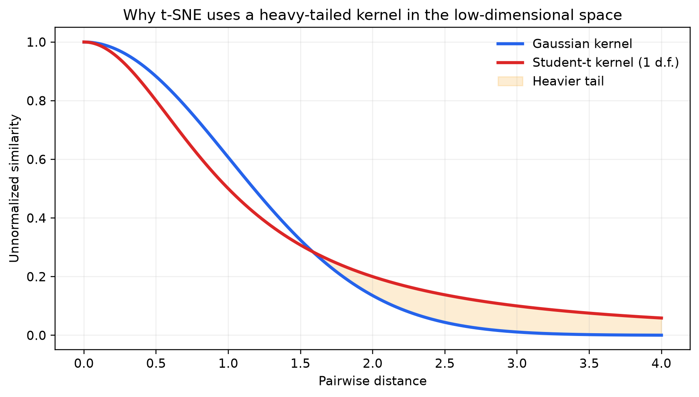

In text retrieval, RAG, and question-answering dataset research, an embedding model commonly encodes each question, answer, or knowledge unit as a high-dimensional vector. A BGE-M3 embedding, for example, may contain more than one thousand dimensions. We can calculate cosine similarity between such vectors, but we cannot directly inspect their spatial distribution.



**t-distributed Stochastic Neighbor Embedding (t-SNE)** provides a way to visualize these representations. It maps high-dimensional vectors into two or three dimensions while attempting to preserve local neighborhood relationships.

Three details in that description are easy to overlook:

1. t-SNE primarily preserves neighborhoods, not every pairwise distance.
2. It optimizes the difference between two probability distributions rather than directly minimizing coordinate error.
3. A t-SNE map supports exploratory analysis, but it cannot by itself prove greater dataset diversity, knowledge coverage, or retrieval performance.

This article develops these ideas step by step, explains the t-SNE objective, and concludes with a reproducible Python example.

## 1. From high-dimensional vectors to neighborhoods

Let the high-dimensional observations be

$$
X=\{x_1,x_2,\ldots,x_n\}, \qquad x_i\in\mathbb{R}^{D},
$$

where $x_i$ may be the text embedding of a question or a knowledge unit. We want to obtain low-dimensional coordinates

$$
Y=\{y_1,y_2,\ldots,y_n\}, \qquad y_i\in\mathbb{R}^{2}.
$$

A seemingly direct approach would require every low-dimensional distance to reproduce its high-dimensional counterpart. In general, however, all high-dimensional distances cannot be compressed into a plane without distortion. t-SNE therefore asks a different question:

> If two samples are close neighbors in the high-dimensional space, can they also have a high probability of being neighbors in the low-dimensional space?

The method does not try to reproduce every distance exactly. Its main concern is to avoid separating points that were genuine local neighbors.

## 2. High-dimensional space: converting distances into probabilities

For the neighborhood centered on $x_i$, t-SNE uses a Gaussian kernel to define the conditional probability that $x_j$ is selected as a neighbor:

$$
p_{j\mid i}
=
\frac{
\exp\left(-\lVert x_i-x_j\rVert^2/2\sigma_i^2\right)
}{
\sum_{k\ne i}
\exp\left(-\lVert x_i-x_k\rVert^2/2\sigma_i^2\right)
},
\qquad p_{i\mid i}=0.
$$

This expression has a useful interpretation:

- a shorter distance produces a larger exponential term and a higher neighbor probability;
- $\sigma_i$ controls the effective neighborhood around $x_i$;
- the denominator normalizes the similarities so that the candidate-neighbor probabilities sum to one.

t-SNE then symmetrizes the conditional probabilities:

$$
p_{ij}=\frac{p_{j\mid i}+p_{i\mid j}}{2n}.
$$

The resulting $P=\{p_{ij}\}$ describes the neighbor-probability distribution in the original space.

### What does perplexity control?

t-SNE does not require every point to use the same $\sigma_i$. It adjusts each value through a binary search until the conditional distribution reaches the user-specified perplexity:

$$
\operatorname{Perp}(P_i)=2^{H(P_i)},
$$

where

$$
H(P_i)=-\sum_j p_{j\mid i}\log_2 p_{j\mid i}.
$$

Perplexity is often interpreted as the effective number of neighbors considered by the algorithm, although it is not a literal neighbor count. A small value emphasizes highly local relationships, whereas a larger value considers a broader neighborhood. The selected value can therefore change the layout substantially.



*Figure 1. The same synthetic high-dimensional data under different perplexity settings. Colors show the classes used to generate the synthetic data and help reveal changes in the projection.*

## 3. Low-dimensional space: why not use another Gaussian?

In the low-dimensional space, t-SNE defines similarity with a Student-t distribution with one degree of freedom:

$$
q_{ij}
=
\frac{
\left(1+\lVert y_i-y_j\rVert^2\right)^{-1}
}{
\sum_{k\ne l}
\left(1+\lVert y_k-y_l\rVert^2\right)^{-1}
},
\qquad q_{ii}=0.
$$

The Student-t distribution has a heavier tail than a Gaussian distribution. As distance increases, its similarity decreases more slowly:



*Figure 2. The heavier tail of the Student-t kernel gives the low-dimensional representation more room to separate dissimilar points. The curves show unnormalized similarities and are intended only to illustrate the kernel shapes.*

This design helps address the **crowding problem**. A point in a high-dimensional space can have many neighbors located in different directions. A two-dimensional plane has much less room to accommodate all these relationships. If a Gaussian kernel were also used in the low-dimensional space, many points would tend to become crowded together. The heavy-tailed distribution gives moderately and strongly dissimilar points more freedom to move apart.

## 4. Why minimize KL divergence?

We now have two distributions:

- $P=\{p_{ij}\}$ represents neighbor relationships in the high-dimensional space;
- $Q=\{q_{ij}\}$ represents neighbor relationships in the low-dimensional space.

t-SNE makes $Q$ approximate $P$ by minimizing the Kullback--Leibler divergence:

$$
\mathcal{L}
=
KL(P\parallel Q)
=
\sum_{i\ne j}p_{ij}\log\frac{p_{ij}}{q_{ij}}.
$$

The objective can be understood through two types of mismatch.

### Separating true neighbors

If two points are close in the high-dimensional space, $p_{ij}$ is relatively large. Placing them far apart in the map makes $q_{ij}$ small, producing a large contribution to the loss. Optimization therefore tends to pull them closer.

### Placing unrelated points too close

When $p_{ij}$ is small, the corresponding pair receives less direct weight in the objective. In this sense, $KL(P\parallel Q)$ is especially sensitive to separating genuine high-dimensional neighbors. Repulsive interactions still arise through the normalized low-dimensional distribution and the gradient, but the final map should not be interpreted as preserving all non-neighbor distances faithfully.

This asymmetry helps explain why t-SNE often reveals local clusters but does not guarantee reliable global geometry. KL divergence itself is asymmetric:

$$
KL(P\parallel Q)\ne KL(Q\parallel P).
$$

By choosing $KL(P\parallel Q)$, t-SNE treats $P$ as the reference distribution to preserve and $Q$ as the low-dimensional approximation to optimize.

## 5. How does gradient descent move the points?

Differentiating the objective with respect to $y_i$ gives

$$
\frac{\partial \mathcal{L}}{\partial y_i}
=
4\sum_j
(p_{ij}-q_{ij})
(y_i-y_j)
\left(1+\lVert y_i-y_j\rVert^2\right)^{-1}.
$$

This can be interpreted as a balance between attraction and repulsion:

- if $p_{ij}>q_{ij}$, the map underestimates the pair's neighborhood relationship and tends to pull the points together;
- if $p_{ij}<q_{ij}$, the map overestimates their neighborhood relationship and tends to push them apart.

Starting from an initial set of low-dimensional coordinates, repeated gradient updates reduce the KL divergence and form the final layout. The optimization problem is non-convex, so different initializations and random seeds can produce different coordinates.

## 6. A reproducible text-embedding example

The following example encodes four questions with BGE-M3 and then applies t-SNE. The very small perplexity is appropriate only because this demonstration contains four samples.

```python
from sentence_transformers import SentenceTransformer
from sklearn.manifold import TSNE
import matplotlib.pyplot as plt
import numpy as np


questions = [
    "How should fire-damaged concrete be assessed?",
    "What tests are required after a structural fire?",
    "How is residual concrete strength calculated?",
    "What is the purpose of post-fire inspection?",
]

model = SentenceTransformer("BAAI/bge-m3")
embeddings = model.encode(
    questions,
    normalize_embeddings=True,
)

tsne = TSNE(
    n_components=2,
    perplexity=2,
    init="pca",
    learning_rate="auto",
    max_iter=1000,
    random_state=42,
)

coordinates = tsne.fit_transform(np.asarray(embeddings))

plt.scatter(coordinates[:, 0], coordinates[:, 1])
for index, point in enumerate(coordinates):
    plt.annotate(f"Q{index + 1}", point)

plt.xlabel("t-SNE dimension 1")
plt.ylabel("t-SNE dimension 2")
plt.title("t-SNE projection of question embeddings")
plt.tight_layout()
plt.show()
```

For a real experiment, at least the following settings should be reported:

| Setting | Example |
| --- | --- |
| Embedding model | `BAAI/bge-m3` |
| Input field | English question text only |
| Preprocessing | L2-normalized embeddings |
| Number of dimensions | 2 |
| Perplexity | 30 |
| Initialization | PCA |
| Learning rate | Auto |
| Iterations | 1,000 |
| Random seed | 42 |

Simply stating that “t-SNE was used for dimensionality reduction” is insufficient because these choices influence the result.

## 7. Comparing original questions, added questions, and knowledge units

Suppose we want to visualize three groups together:

- original questions;
- added questions;
- knowledge units.

All texts should first be encoded with the same embedding model. Their vectors should then be concatenated and fitted in **one joint t-SNE projection**:

```python
all_embeddings = np.vstack(
    [
        original_question_embeddings,
        added_question_embeddings,
        knowledge_unit_embeddings,
    ]
)

all_coordinates = tsne.fit_transform(all_embeddings)
```

The three groups should not be fitted separately and then overlaid. Every t-SNE run creates a new coordinate system that may be rotated, reflected, translated, or distorted relative to another run. Coordinates from independently fitted maps are not directly comparable.

Before-and-after dataset comparisons should likewise use a joint projection or a carefully defined shared coordinate strategy. Even in a joint fit, apparent movement does not automatically demonstrate improved coverage because adding points changes the optimization problem itself.

A suitable caption for a dataset-expansion figure is:

> **t-SNE projection of question and knowledge-unit embeddings before and after dataset expansion.** Gray and blue points represent the original and added questions, respectively, while orange points represent the knowledge units.

## 8. What can a t-SNE map support?

t-SNE is useful for exploratory observations such as:

- whether some questions form local semantic neighborhoods;
- whether added questions concentrate around existing questions;
- whether isolated samples warrant manual inspection;
- whether questions and relevant knowledge units appear near each other locally;
- whether question types exhibit some local organization.

These observations should be phrased cautiously, using language such as “suggests,” “indicates a local pattern,” or “supports exploratory inspection,” rather than being presented as causal or performance conclusions.

## 9. What can it not prove by itself?

### The axes have no domain meaning

`t-SNE dimension 1` and `t-SNE dimension 2` are optimized coordinates. They do not represent fire severity, question difficulty, or relevance to a standard.

### Distances between clusters are not reliable global semantic distances

Two clusters that appear far apart are not necessarily separated by the same degree in the original embedding space.

### Cluster area and density do not equal data quality

A more dispersed dataset is not necessarily more diverse. It may instead contain noise, poor paraphrases, or semantic drift.

### Visually separated groups do not prove real classes

t-SNE emphasizes local neighborhoods. It can produce visually distinct regions even when the original data do not contain clean discrete categories.

### t-SNE is not a substitute for quantitative evaluation

Claims about diversity and coverage should also be supported with measures such as:

- pairwise cosine similarity;
- nearest-neighbor similarity;
- exact and near-duplicate rates;
- knowledge-unit coverage;
- retrieval Recall@k or evidence hit rate;
- downstream model performance and human quality review.

t-SNE is exploratory evidence, not a replacement for these measurements.

## 10. A practical checklist

Before publishing a t-SNE figure, check the following:

1. Were all comparison groups encoded with the same model and the same text field?
2. Were the groups fitted together in one projection?
3. Are perplexity, initialization, iteration count, and random seed reported?
4. Is the data version fixed, with hashes recorded where possible?
5. Were multiple perplexities or seeds checked to assess the stability of major local patterns?
6. Does the caption state the group colors, sample counts, and projection method?
7. Does the interpretation avoid treating global 2D distances as original semantic distances?
8. Are independent quantitative metrics used to support claims about diversity, coverage, or retrieval performance?

## Conclusion

t-SNE is more than a procedure that compresses high-dimensional coordinates into a plane. It first represents both the high-dimensional and low-dimensional spaces as neighbor-probability distributions, and then minimizes

$$
KL(P\parallel Q)
$$

to preserve local neighborhoods. Gaussian probabilities describe neighbors in the original space, the heavy-tailed Student-t distribution helps reduce crowding in the map, and the KL-divergence objective places particular emphasis on not separating genuine neighbors.

These design choices also define the method's limits. t-SNE is highly useful for exploring local structures in an embedding space, but its two-dimensional geometry cannot replace quantitative analysis in the original space. For QA augmentation and RAG knowledge-base research, a sound analysis combines t-SNE with duplicate rates, cosine similarities, knowledge coverage, retrieval metrics, and human review.

## References

1. van der Maaten, L., & Hinton, G. (2008). Visualizing Data using t-SNE. *Journal of Machine Learning Research, 9*, 2579–2605.
2. van der Maaten, L. (2014). Accelerating t-SNE using Tree-Based Algorithms. *Journal of Machine Learning Research, 15*, 3221–3245.
3. Wattenberg, M., Viégas, F., & Johnson, I. (2016). How to Use t-SNE Effectively. *Distill*. https://doi.org/10.23915/distill.00002
